# LanCache Dashboard

A lightweight, self-hosted dashboard for monitoring a [LanCache](https://lancache.net/) instance. It shows real-time downloads, how much WAN bandwidth your cache is saving, per-service and per-client breakdowns, and which games are sitting in your cache — with cover art.

  

Built to stay light on resources and tiny on disk, even when your access logs grow into the hundreds of gigabytes. It pre-aggregates log data instead of storing raw lines, so the database stays small no matter how big the logs get.

---

## Screenshots

*Real data from a production LanCache, with client IPs anonymized. Live downloads show simulated traffic.*

### Dashboard
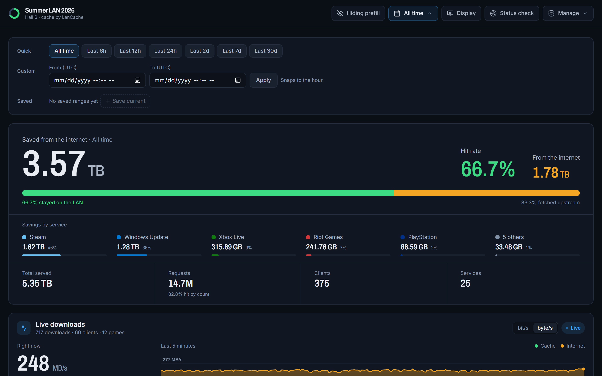

### Event Display (`/display`)
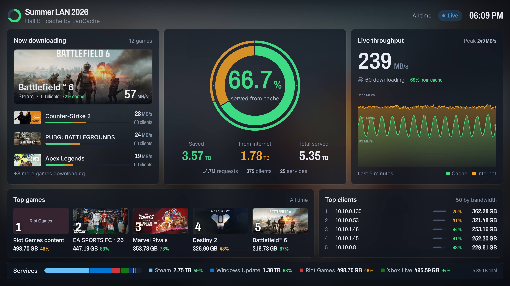

### Cache Summary
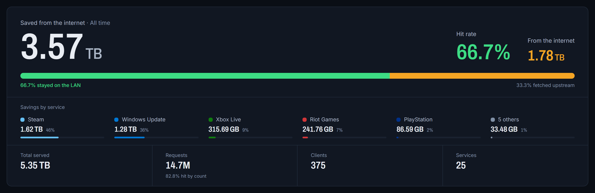

### Time Range Filter
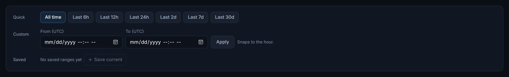

### Live Downloads
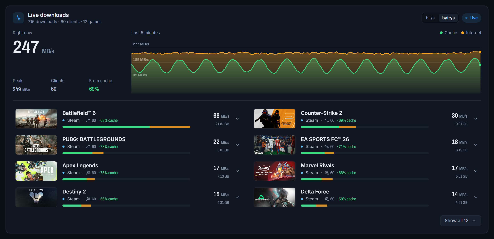

### Bandwidth Trend
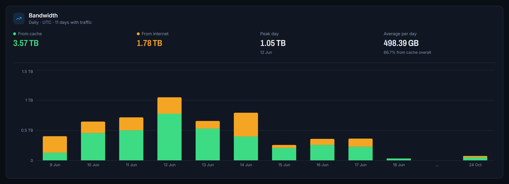

### Services Breakdown
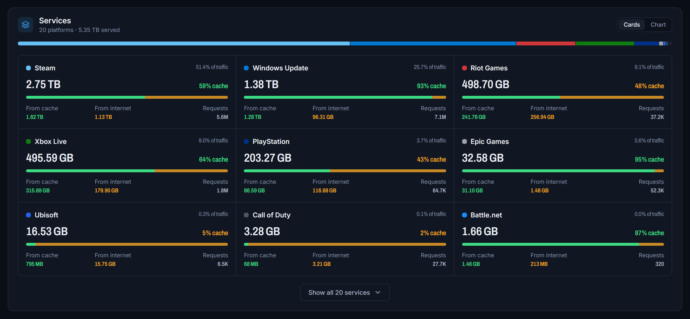

### Recent Activity
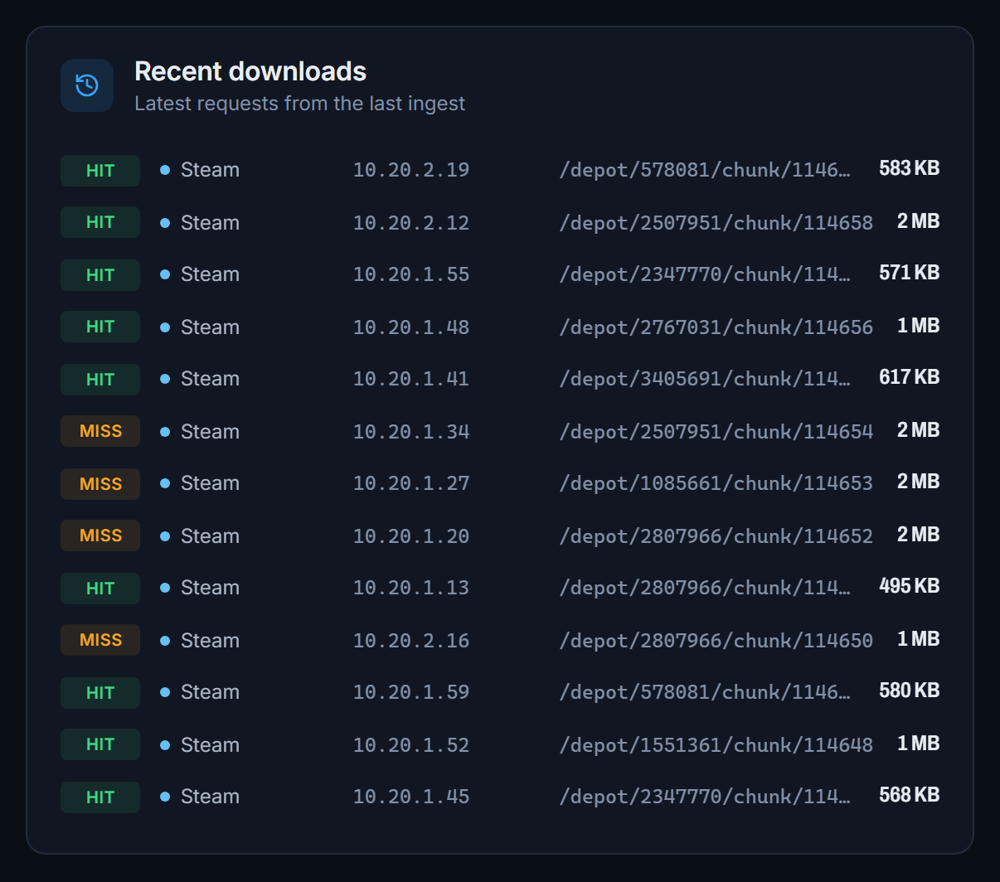

### Cached Games
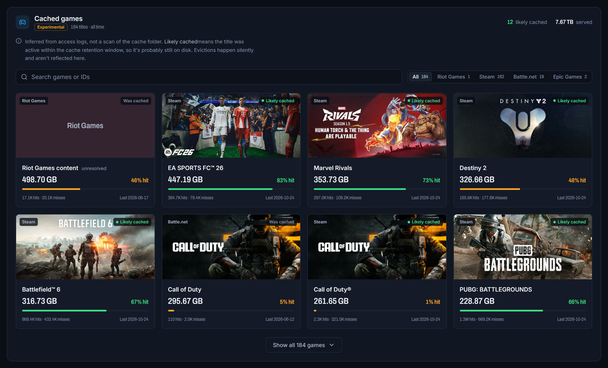

### Clients
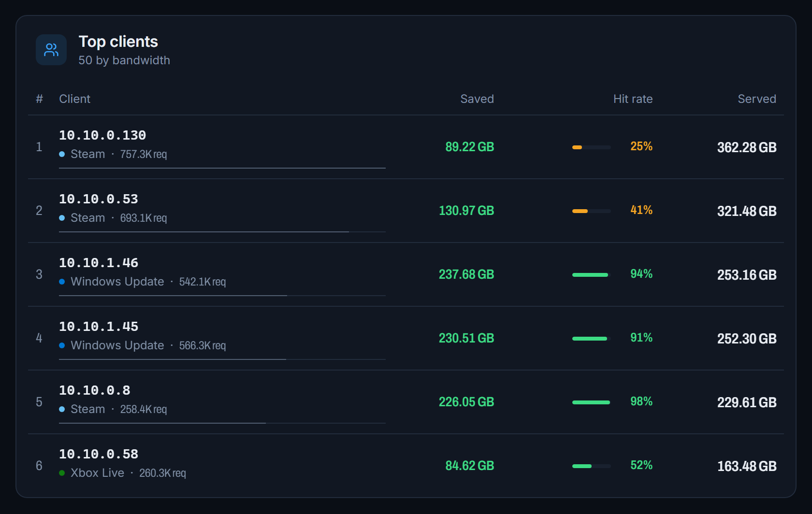

### Status Check
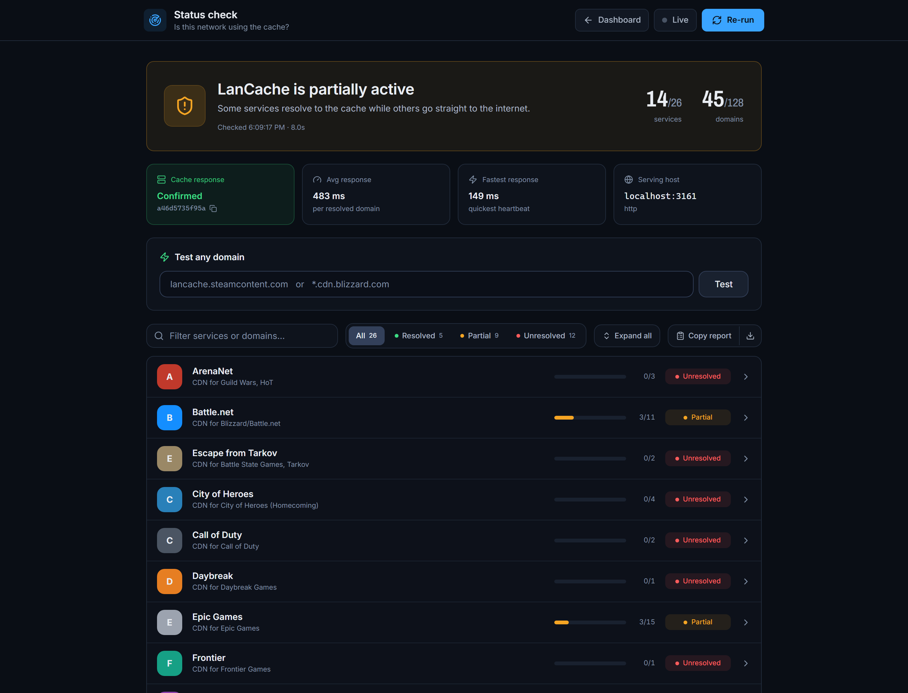

---

## Features

- **Cache savings at a glance** — The summary shows how much bandwidth was served from cache vs fetched from the internet, the hit rate, and which services the savings came from.
- **Live downloads** — A persistent server-side tailer tracks downloads across **all services** in real time, **grouped by game** (e.g. "Battlefield 6 · 42 clients · 1.2 GB/s · 71% cache") with a scrolling 5-minute throughput chart. Expand a game to see each client. Built for events: the server computes one snapshot per second regardless of how many people are watching, sends only the top 25 games (plus a "+N more" total), and fetches per-client detail only when someone expands a row. Open the page mid-download and you immediately see what's active.
- **Cached games with cover art** — Steam depots are resolved to real game names and header images. See which games have passed through your cache, their size, and hit rate. *(Experimental — see note below.)*
- **Per-service breakdown** — Bandwidth, requests, cache savings, and hit rate for each platform (Steam, Epic, Battle.net, Riot, WSUS, etc.), as cards or a donut chart.
- **Top clients leaderboard** — Which machines pulled the most, how much they saved from cache, and their hit rate.
- **Bandwidth trend** — Stacked cache vs internet bars (hourly, 3-hourly or daily depending on the range), with peak and average figures. Gaps in the data are marked, not smoothed over.
- **Time range filter** — Scope every stat, chart, and table to a window: quick relative presets (last 6h through 30d), a custom UTC from/to range, or your own saved presets shared across viewers. Lives as a compact button in the top bar that expands to the full picker.
- **Automatic ingestion** — New log lines are parsed every 60 seconds. Handles log rotation automatically.
- **Event display** — A fullscreen 16:9 page at `/display` for a TV, projector or second monitor: hit rate, bytes saved, live downloads, top games, services and clients, readable from across a room. *(See [Event display](#event-display) below.)*
- **Your event's branding** — Swap in your own name, tagline, logo and accent colour without rebuilding. *(See [Branding](#branding).)*
- **Status Check page** — A standalone `/status` checker that tests, from the visitor's own browser, whether their network is routing supported services through a LanCache. Useful for sharing with users on your network. *(See [Status Check](#status-check) below.)*
- **Tiny footprint** — Hundreds of GB of logs aggregate down to a SQLite DB measured in megabytes.

---

## Quick Start (Docker)

1. Create your compose file from the template:

   ```bash
   cp docker-compose.example.yml docker-compose.yml
   ```

2. Edit `docker-compose.yml` — point the volume at your LanCache log directory and set any options:

   ```yaml
   volumes:
     - /path/to/your/lancache/logs:/logs:ro   # your access.log lives here
     - ./data:/app/data                        # DB + depot mappings persist here
   ```

3. Prepare the data directory (the container runs as UID 1001):

   ```bash
   mkdir -p data && sudo chown -R 1001:1001 data
   ```

4. Start it (pulls the prebuilt image from GHCR):

   ```bash
   docker compose up -d
   ```

   To grab a newer release later, run `docker compose pull && docker compose up -d`.

5. Open `http://your-server-ip:3000`

Your `docker-compose.yml` is gitignored, so any credentials you put in it stay local. On first launch the dashboard ingests your `access.log` and downloads the Steam depot mapping in the background (see [Game identification](#game-identification)).

---

## Quick Start (Bare Metal)

Requires Node.js 20+.

```bash
npm install

# Point at your access.log
export LOG_PATH=/path/to/lancache/logs/access.log
export DB_PATH=./data/lancache.db

npm run build
npm start
```

Open `http://localhost:3000`.

For development:

```bash
npm run dev
```

---

## Configuration

| Variable | Default | Description |
|----------|---------|-------------|
| `LOG_PATH` | `../logs/access.log` | Path to your LanCache `access.log` |
| `DB_PATH` | `../data/lancache.db` | Path for the SQLite database. The Steam depot mapping is stored alongside it in the same directory. |
| `EXCLUDE_IPS` | `127.0.0.1,::1,172.,localhost` | Comma-separated IPs/prefixes hidden from stats by default. Prefill traffic from the cache host (often the Docker bridge `172.18.0.1`) misses heavily and skews real client numbers. Entries ending in `.` or `:` are treated as prefixes. Setting this **replaces** the default list. Toggle on/off live in the UI. |
| `PREFILL_IPS` | *(empty)* | Extra IPs/prefixes treated as prefill, **added** to `EXCLUDE_IPS`. Use this when you run prefill from a LAN workstation instead of the cache host, e.g. `PREFILL_IPS=192.168.1.50`. Same format as `EXCLUDE_IPS`. |
| `RESOLVE_HOSTNAMES` | `false` | Set to `true` to show client hostnames via reverse DNS (PTR). See [Client names](#client-names). |
| `CACHE_MAX_AGE_DAYS` | `60` | Your lancache cache retention window. Used to estimate whether a game is "likely still cached" (last seen within this many days). Match it to your lancache `CACHE_MAX_AGE`. |
| `PORT` | `3000` | Server port |

> **Prefill / localhost traffic** — Prefill is *expected* to miss almost everything. Counting it tanks your apparent hit rate (e.g. 24% real → 5% with prefill). By default the dashboard hides the cache host's IPs from all stats and the live view, but keeps ingesting them, so you can flip the **Hiding/Showing prefill** toggle in the header at any time without re-processing logs.
>
> If you run the prefill tools (SteamPrefill, BattleNetPrefill, EpicPrefill) from **another machine on the LAN**, its traffic looks like a normal client. Add that machine's IP to `PREFILL_IPS` and it's treated the same way. When **Showing prefill**, those clients are tagged *Prefill* in Clients and Live Downloads. Cached Games totals aren't split per client, so prefill bytes still count there (prefill is what put those games in the cache).

> **Data directory** — The depot mapping file (~100MB) and the SQLite database both live in the directory that contains `DB_PATH`. Make sure that directory is on a persistent volume.

---

## Event display

Open **`/display`** (the **Display** button in the header) on the machine driving a TV or projector. It's a read-only, fullscreen 16:9 view of the public stats, laid out to be read from across a room:

- **Backdrop:** the cover art of whatever is downloading fastest, blurred and darkened, crossfading as the top download changes. When idle it uses the most-cached game.
- **Left:** "Now downloading" with the top game as a large art card (clients, speed, cache %), the next few below it, and a "+N more" count. When idle it shows the most-cached game and recent activity by client.
- **Center:** a cache meter. The thick inner ring is the hit rate for the selected time range, and the thin outer ring is the cache/internet split of traffic flowing right now (it updates every second). Bytes saved, fetched upstream and total count up beneath it.
- **Right:** live speed and a scrolling 5-minute cache/internet throughput chart.
- **Bottom:** the top 5 games as posters with ranks, top clients, and a services ribbon.

The layout is a fixed 16:9 stage that scales to any screen, letterboxed when the window isn't 16:9. Move the mouse to reveal **Fullscreen** and **Dashboard** buttons (or press <kbd>F</kbd>); they and the cursor hide after 3 seconds. The stage shifts a few pixels every five minutes to reduce burn-in on panels left running all day.

It uses this browser's dashboard settings (time range, prefill toggle, speed unit). You can override them in the URL, which is handy for a kiosk machine:

| Parameter | Example | Effect |
|---|---|---|
| `hours` | `/display?hours=24` | Relative range |
| `saved` | `/display?saved=3` | A saved range (the ID from `/api/ranges`) |
| `start` + `end` | `/display?start=2026-07-01T18&end=2026-07-03T02` | Absolute range (UTC hours) |
| `prefill` | `/display?prefill=show` | Include prefill / excluded clients |
| `unit` | `/display?unit=bits` | Live speed in bit/s |
| `clients` | `/display?clients=hide` | Replace client IPs/hostnames with "Client 1, 2…" |

Top games are always **all time**, because cached-game totals aren't stored per time range.

---

## Branding

Make the dashboard and display your event's own. Everything is optional, and nothing needs a rebuild.

| Setting | Example | Effect |
|---|---|---|
| `BRAND_NAME` | `Summer LAN 2026` | Replaces "LanCache" in the header, the display, and the browser tab |
| `BRAND_TAGLINE` | `Hall B · cache by LanCache` | A short second line under the name |
| `BRAND_ACCENT` | `#ff7a45` | Hex colour for live and interactive marks (Live dot, focus rings, active buttons) |
| `brand-logo.svg` / `.png` / `.webp` / `.jpg` | in the data directory | Shown instead of the default mark. Max 2 MB. Swap the file any time; viewers pick it up on reload. |

Green (served from cache) and amber (from the internet) are fixed, so the data always means the same thing. If `BRAND_ACCENT` is close to either, the server logs a warning and suggests another hue.

---

## Client names

Clients, Live Downloads, and Recent Downloads can show a hostname next to the IP (`CHIKO-PC  192.168.1.175`). There are two optional sources:

- **`client-names.json`** in the data directory: a plain `{ "192.168.1.175": "CHIKO-PC" }` map. Always takes priority, and it's re-read when the file changes, so you can label seats mid-event without a restart.
- **Reverse DNS**, enabled with `RESOLVE_HOSTNAMES=true`. This only works if your DHCP/DNS server registers client hostnames (pfSense/OPNsense, dnsmasq, Windows DNS, most consumer routers). Lookups run in the background and are cached (1h for found names, 10 min for misses), so a new client's name shows up on the next refresh. In Docker, the container uses the host's DNS servers. If those aren't your LAN resolver, set `dns: [<router-ip>]` in your compose file.

Hostnames are visible to everyone who can open the dashboard. Machine names often include people's real names, so keep that in mind before turning this on for a public event.

---

## Security

The dashboard is built for a trusted LAN, but it ships with two opt-in protections — worth enabling if anyone besides you can reach it.

| Variable | Effect |
|----------|--------|
| `ADMIN_API_KEY` | Splits users into **viewers** and **admins**. Without the key, everyone can see every stat, chart, live download, and the Status Check page, but the **Manage** menu (ingest, rebuild, update depots) is hidden and saved time ranges are read-only. Enter the key once via the **Admin** button in the UI (stored in your browser). Recommended for LAN events: share the URL with every participant and keep the key to yourself. Use a long random key, e.g. `openssl rand -hex 24`. |
| `DASHBOARD_USER` + `DASHBOARD_PASSWORD` | When both are set, the **entire** dashboard (UI + API) is behind HTTP Basic Auth — nobody sees anything without the credentials. Use this for stricter setups. Works together with `ADMIN_API_KEY`. |

**Viewer vs Admin at a glance** (with `ADMIN_API_KEY` set):

| | Viewer | Admin |
|---|---|---|
| Stats, charts, live downloads, cached games, clients, services | ✓ | ✓ |
| Status Check, time range filter, prefill toggle | ✓ | ✓ |
| Ingest / rebuild / update depots | — | ✓ |
| Create or delete saved time ranges | — | ✓ |

Other notes:
- Read endpoints (stats, clients, games, live) are intentionally open so the dashboard "just works" for viewers. Only mutating actions are gated by `ADMIN_API_KEY`.
- Mutating actions are also single-flight (a second trigger returns 409 while one is running), which blunts abuse.
- Security headers (`X-Frame-Options`, `X-Content-Type-Options`, `Referrer-Policy`) are always applied.
- **Don't expose this directly to the internet.** Keep it on your LAN, or bind to localhost (`127.0.0.1:3000:3000` in compose) and put it behind a reverse proxy with TLS + auth if you need remote access.
- No SQL injection (parameterized queries), no path traversal (paths come from env), no command execution, and the one outbound fetch endpoint is locked to Steam's host.

---

## How It Works

1. **Parser** reads `access.log` incrementally, tracking the byte offset so it only processes new lines. It detects log rotation (file shrinking) and starts over when needed.
2. **Aggregator** rolls each line into hourly and daily summary tables keyed by service and client. It tracks bytes served from cache (HIT) separately from bytes fetched upstream (MISS), so cache savings are accurate.
3. **Auto-ingest** runs every 60 seconds in the background, processing up to 500k new lines per cycle.
4. **API routes** serve the pre-aggregated data.
5. **Frontend** (Next.js + Tailwind + Recharts) renders the dashboard and refreshes periodically. The live view streams new log lines over SSE.

Because only aggregates are stored, a multi-hundred-GB log history collapses into a database of tens of megabytes.

---

## Game identification

The access log only contains Steam **depot IDs** (e.g. `/depot/2347771/chunk/...`), not game names. Mapping a depot to its game accurately requires Steam's PICS data, which normally needs an authenticated Steam session.

Instead of logging in, this dashboard uses a **pre-built depot → app mapping** published by the [lancache-manager](https://github.com/regix1/lancache-manager) project. On first run it downloads [`pics_depot_mappings.json`](https://github.com/regix1/lancache-pics) (~100MB, ~244k mappings, refreshed daily) and caches it locally. Depot resolution is then an instant, accurate local lookup — game names and cover images included. For depots not yet in the snapshot (brand-new releases), it falls back to the public Steam store API.

**Battle.net** games are resolved using TACT product codes embedded in CDN hostnames (e.g. `cod-assets.cdn.blizzard.com` → Call of Duty). The product list is based on [tpill90/battlenet-lancache-prefill](https://github.com/tpill90/battlenet-lancache-prefill).

**Epic Games** titles are named from the build artifact in the download path (e.g. `/Builds/Fortnite/...` → *Fortnite*). Epic has no public artifact → artwork mapping, so there's no cover art by default.

**Other services (Riot, EA, Ubisoft, etc.)** cannot currently be resolved to game names — their CDN URLs are opaque hashes with no known public mapping. They're shown at the service level only.

### Custom game names & artwork

For anything the built-in resolvers miss (Battle.net titles without a Steam version, Epic games, a Steam depot that resolves wrong), create `game-overrides.json` in the data directory (next to the DB):

```json
{
  "blizzard:wow":       { "name": "World of Warcraft", "image": "https://example.com/wow.jpg" },
  "epicgames:Fortnite": { "image": "https://example.com/fortnite.jpg" },
  "steam:2807966":      { "name": "Battlefield 6" }
}
```

Keys are `<service>:<gameId>` (case-insensitive). The game ID is the Steam depot, the Battle.net product code, or the Epic artifact name. Either field is optional. Images must be `http(s)` URLs and are loaded by each viewer's browser. The file is re-read automatically when it changes, so you don't need to restart. Overrides apply to Cached Games and Live Downloads.

---

## Cached Games — what "cached" means (Experimental)

This section is marked **Experimental** because it is **inferred from access logs, not a live scan of the cache folder.** Logs can't tell you what's physically on disk right now — nginx evicts content silently (LRU + max-age) without logging anything the parser can see. So the dashboard uses two honest signals:

- **Likely cached** — the title was active within your cache retention window (`CACHE_MAX_AGE_DAYS`, default 60). It was downloaded or served recently, so it's *probably* still on disk. This is the green badge.
- **Was cached** — served from cache historically, but not recently. It may have been evicted.

A game downloaded once (all cache MISSes, which *populate* the cache) correctly shows as "likely cached" even though it never had a HIT — because downloading it put it on disk. Conversely, a game last seen months ago is shown as "was cached" since it has probably been pruned.

For disk-accurate "what's actually cached right now", a full cache-folder scanner would be needed (reading each cached file's header to recover the original URL). That's a heavier, opt-in feature and isn't part of this build.

---

## Status Check

A standalone page at **`/status`** (linked from the header) that answers a single question for anyone on your network: *is my connection actually using the cache?* It's the modern, browser-based equivalent of the old "is LanCache working?" pages, and the official [uklans/diagnostics](https://github.com/uklans/diagnostics) tool.

How it works: the visitor's browser sends a tiny `/lancache-heartbeat` request to each CDN hostname from the [uklans/cache-domains](https://github.com/uklans/cache-domains) list. A LanCache instance answers with an HTTP `204` and an `X-LanCache-Processed-By` header identifying itself; a real CDN has no such endpoint, so the request is rejected. Because the checks run in *the visitor's* browser, the results reflect *their* network path — not the server's.

- **Overall verdict** — a clear "active / partial / not detected" banner, plus the responding cache instance as proof.
- **Per-service results** — every service from the community domain list, each expandable to show its individual domains with latency and Resolved/Unresolved status.
- **Search & filter** — narrow the list by name/domain or filter to only Partial/Unresolved services.
- **Live mode** — optionally re-run the checks every 5–30s while the page is open (checks run client-side, so nothing runs in the background).
- **Copy / download report** — export a plain-text summary to share when troubleshooting.

> Every check runs **entirely in the visitor's browser** against their own connection, so results reflect the network they're actually on — not the server hosting the page. For accurate results the page must be served over `http://` — browsers block secure pages from reaching the cache's plain-HTTP heartbeat (a warning is shown when loaded over HTTPS).

---

## Manual Ingestion

The dashboard ingests automatically, but you can trigger a pass manually:

```bash
curl -X POST http://localhost:3000/api/ingest
```

Or click **Ingest Logs** in the dashboard header.

---

## Systemd Service (Optional)

```ini
[Unit]
Description=LanCache Dashboard
After=network.target

[Service]
Type=simple
User=lancache
WorkingDirectory=/opt/lancache-dashboard
Environment=LOG_PATH=/var/log/lancache/access.log
Environment=DB_PATH=/opt/lancache-dashboard/data/lancache.db
Environment=PORT=3000
ExecStart=/usr/bin/node .next/standalone/server.js
Restart=unless-stopped

[Install]
WantedBy=multi-user.target
```

---

## Tech Stack

- [Next.js 16](https://nextjs.org/) (App Router) — UI and API in a single process
- [better-sqlite3](https://github.com/WiseLibs/better-sqlite3) — embedded database, no external service
- [Tailwind CSS](https://tailwindcss.com/) — styling
- [Recharts](https://recharts.org/) — charts
- [lucide-react](https://lucide.dev/) — icons

---

## Credits & Acknowledgements

- **[LanCache.NET](https://lancache.net/)** — the caching system this dashboard monitors.
- **[regix1/lancache-manager](https://github.com/regix1/lancache-manager)** and **[regix1/lancache-pics](https://github.com/regix1/lancache-pics)** — for the pre-built Steam depot → app mapping that powers Steam game identification. The lancache-manager project is MIT licensed.
- **[tpill90/battlenet-lancache-prefill](https://github.com/tpill90/battlenet-lancache-prefill)** — for the Battle.net TACT product code reference used to resolve Blizzard/Activision game names from CDN hostnames.
- **[DeveLanCacheUI](https://github.com/devedse/DeveLanCacheUI_Backend)** — prior art and inspiration for log-based LanCache monitoring.
- **[uklans/cache-domains](https://github.com/uklans/cache-domains)** — the canonical list of cacheable CDN domains that LanCache routes, used as the service registry reference and by the Status Check page.
- **[uklans/diagnostics](https://github.com/uklans/diagnostics)** — the official LanCache diagnostics tool, referenced when designing the browser-based Status Check page.
- **Steam Store Web API** — for resolving depots not yet in the PICS snapshot, and for header art.

Game names, cover images, and related metadata are property of their respective owners and are used here for identification purposes only.

---

## Contributors & Bug Reports

Thanks to everyone who has run this in the wild and helped make it better:

- **[MathewBurnett](https://github.com/MathewBurnett)** — reported and diagnosed the ingestion double-counting bug (parse cursor not advancing atomically per batch, causing replays on crash/restart/overlap to double-count) during a live event.

Found a bug or have an improvement? [Open an issue](https://github.com/imahmud1/lancache-dashboard/issues).

---

## License

Released under the [MIT License](./LICENSE).
